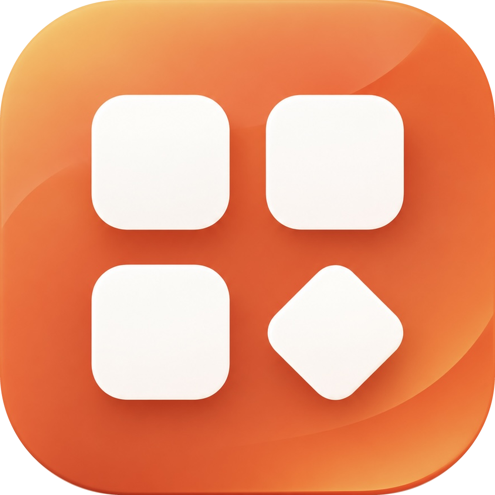

# Open Tools

[English](README.md) | [简体中文](README.zh-CN.md) | 日本語

**Windows 向け開発者ツールボックス**

JSON・エンコード・変換・画像・音声・文書などのよく使うツールを、デスクトップアプリ 1 つにまとめました。ほとんどの処理は PC 上で行い、ファイルをアップロードしません。

[ダウンロード](#ダウンロードとインストール) · [機能](#機能) · [使い方のヒント](#使い方のヒント) · [Star の推移](#star-の推移)

---

## 概要

JSON の整形、Base64 のデコード、タイムスタンプの変換、画像の圧縮……。こうした作業のたびに別々の Web サイトを開き、データがどこに送られるのか気にしていませんか。Open Tools はこれらの日常的なツールを 1 つのデスクトップアプリにまとめます。

- **ローカル処理**：ファイルや内容は PC 上で処理します。ネットワークにアクセスする機能は[プライバシー](#プライバシー)を参照してください。
- **すぐに使える**：Windows インストーラーに AI 実行環境を同梱。モデルは必要に応じてダウンロードし、画像の推論はローカルで行います。
- **1 つの画面で完結**：上部でカテゴリを切り替え、左のサイドバーでツールを選び、`Ctrl K` でいつでも検索できます。
- **作業内容を保持**：ツールを切り替えても、直前の入力と結果は残ります。
- **ホーム**：お気に入り、最近使ったツール、利用状況、予定の通知をまとめて確認できます。
- **自動アップデート**：新しいバージョンがあるとアプリ内で通知し、そのまま更新できます。
- **多言語対応**：簡体字中国語・English・日本語に対応し、初期設定ではシステムの言語に従います。

## 機能

9 カテゴリ、74 ツール：

| カテゴリ | ツール |
| --- | --- |
| 開発ツール | JSON の整形と検証（コード / ツリー表示）、差分比較、エスケープ、YAML 変換、TypeScript 型生成、Base64、URL / Unicode / HTML エンコード、ハッシュ計算、JWT デコード、正規表現テスト、命名規則の変換、MCP ツールビューアー |
| 日常ツール | パスワード生成、パスワード帳、クリップボード履歴、スクリーンショットとデスクトップへのピン留め、身分証番号の解析、ノートブック |
| 時間 | タイムスタンプ変換、タイムゾーンと世界時計、Cron 式、時計（曜日指定のアラーム、ラップ付きストップウォッチ、複数タイマー）、カレンダー（グレゴリオ暦 / 旧暦、祝祭日、メモ、Windows デスクトップ通知） |
| 計算・換算 | 電卓、単位換算、進数変換 |
| 画像 | 圧縮、形式変換、切り抜き、回転、色調整、結合、モザイク、透かし、背景除去（AI による被写体認識）、透かし除去（AI による補完）、画像の色の取得、カラー変換、DPI 変更、ICO アイコン生成 |
| 音声 | 圧縮、形式変換（動画からの音声抽出を含む）、編集、結合、ボイスレコーダー、テキスト読み上げ |
| 動画 | 動画圧縮、bilibili 動画ダウンロード（アプリ内再生対応）、Douyin の透かしなしダウンロード、小紅書の動画と画像の自動ダウンロード（ローカル再生対応）、X と Weibo の動画ダウンロード、動画から音声へ（元の音声トラックのコピー、または MP3・M4A・WAV に変換）、動画から GIF へ、動画のトリミング（長さと画面）、動画の結合、BGM の追加、画面録画、カメラ録画 |
| 文書 | 大容量テキスト編集（複数タブ・連続スクロール）、Word → PDF、Word → Markdown、PDF → Word、Word の透かし追加と削除、PDF コンテンツ編集（本文の置換、文字・画像・署名・注記）、PDF ページ管理、PDF の透かし削除、Markdown の Word 変換、ファイルの圧縮と展開 |
| ネットワーク | HTTP リクエスト、IP アドレスと位置情報、Ping テスト、MQTT（TCP/TLS、WebSocket）、リクエストヘッダー → JSON / cURL |

## ダウンロードとインストール

### Windows

1. [GitHub の最新リリース](https://github.com/Bulua/open-tools/releases/latest)、または [Gitee のミラー](https://gitee.com/bulua/open-tools/releases)を開きます。
2. `Open Tools_x.x.x_x64-setup.exe` をダウンロードします。
3. インストーラーを実行し、スタートメニューまたはデスクトップのショートカットから Open Tools を起動します。

**動作環境**：64 ビット版 Windows 10 / 11 と WebView2。Word → PDF のローカル変換には、Microsoft Word・WPS・LibreOffice のいずれかが必要です。PDF → Word には Office 不要の内蔵方式もあります。

> **初回起動時に Windows SmartScreen の警告が出る場合**：現在、インストーラーにはコード署名がありません。ダウンロードしたリリースを信頼できる場合は、**詳細情報** → **実行** を選んでください。

#### Windows アップデート

アプリは起動後にアップデートを確認し、スキップしていない新バージョンがあると更新ダイアログを開きます。サイドバー下部の更新確認または新バージョンの項目から、変更内容の確認、ダウンロード、インストールができます。Gitee を優先し、失敗した場合は GitHub に接続します。

## 使い方のヒント

| 操作 | 内容 |
| --- | --- |
| `Ctrl K` | すべてのツールを名前や説明で検索し、Enter で開く |
| サイドバーの検索 | 現在のカテゴリ内のツールを絞り込む |
| お気に入りの星 | ツールをホームのお気に入りに追加。ホームには最近使ったツールも表示 |
| セッションタブ | JSON ツール・正規表現テスト・HTTP リクエスト・ヘッダー変換は独立したセッションに対応。`+` で追加、ダブルクリックで名前を変更、中クリックまたは `×` で閉じる |
| `Ctrl V` | 対応する画像・ファイルツールにスクリーンショットやコピーしたファイルを貼り付ける |
| ドラッグ & ドロップ | 画像やファイルをウィンドウに直接追加する |
| `Ctrl F` | JSON エディター内を検索する |
| サイドバー左下のボタン | サイドバーを折りたたむ |
| 上部のテーマボタン | ライト / ダークテーマを切り替える |
| 上部の言語ボタン | システムに従う / 简体中文 / English / 日本語 を切り替える |
| ウィンドウを閉じる | アプリをシステムトレイに隠す。トレイアイコンのクリックで復元、右クリックで終了 |
| 区切り線をドラッグ | JSON 整形の入力 / 出力欄の幅を調整。ダブルクリックで元に戻す |

起動時はホームを表示し、カテゴリごとに最後に選んだツール、テーマ、言語、よく使う設定を記憶します。アラームとタイマーは保存され、終了中に期限を迎えたものは次回起動時に通知します。ストップウォッチの状態は現在のアプリ実行中のみ保持され、終了後は計測を続けません。

## プライバシー

ネットワークが必要な機能を除き、処理はすべてローカルで行います。

- **アップデートの確認**：Gitee または GitHub からリリース情報を読み取ります。ファイルは送信しません。
- **アプリアイコンの同期**：起動後と実行中に定期的に Gitee / GitHub のアイコン設定を確認し、必要に応じてアイコンをダウンロードします。ユーザーファイルは送信しません。
- **IP の検索**：公開サービス（ip-api.com、ipwho.is、ipapi.co の順）に問い合わせます。検索する IP はサービス提供元に送信され、ip-api.com は暗号化されていない HTTP を使います。
- **HTTP リクエスト**：設定したヘッダー、パラメーター、リクエスト本文を指定したサーバーへ送信します。
- **Ping**：入力したホストに ping を送ります。
- **MQTT**：指定したブローカーに接続し、接続情報や購読トピック、発行メッセージを送信します。接続パスワードと送受信ログは実行中のみ保持します。
- **MCP ツールビューアー**：設定した MCP サーバーへ HTTP で接続するか、設定したローカルプログラムを stdio で起動します。
- **動画ダウンロード**：対象の動画プラットフォームとメディアサーバーにアクセスします。小紅書への直接リクエストに失敗した場合、デスクトップ版は非表示ウィンドウで共有ページを読み込み、共有 URL のパラメーターを小紅書に送信します。
- **AI モデルのダウンロード（背景除去・画像補完）**：要求したときだけモデルをダウンロードします（AI 実行環境 ONNX Runtime はインストーラーに同梱）。まず ModelScope から、失敗したときは Hugging Face から取得します。画像はローカルで処理します。
- **Markdown 内のリモート画像**：HTTP(S) の画像を参照する Markdown を Word に書き出すとき、その URL から画像を取得します。

一部のツールは、履歴や接続設定をローカルに保存します。保存先と形式は[データの保存](docs/development/STORAGE.md)を参照してください。

## 開発ドキュメント

Windows での開発、各ツールの実装、パッケージ作成については[開発ガイド（中国語）](docs/DEVELOPMENT.md)を参照してください。

## Star の推移

Open Tools が役に立ったら、ぜひ Star をお願いします。不具合の報告やツールの提案は [Issues](https://github.com/Bulua/open-tools/issues) までどうぞ。

<a href="https://star-history.com/#Bulua/open-tools&Date">
  <picture>
    <source media="(prefers-color-scheme: dark)" srcset="https://api.star-history.com/svg?repos=Bulua/open-tools&type=Date&theme=dark" />
    
  </picture>
</a>

## ライセンス

[AGPL-3.0](LICENSE) © Bulua
