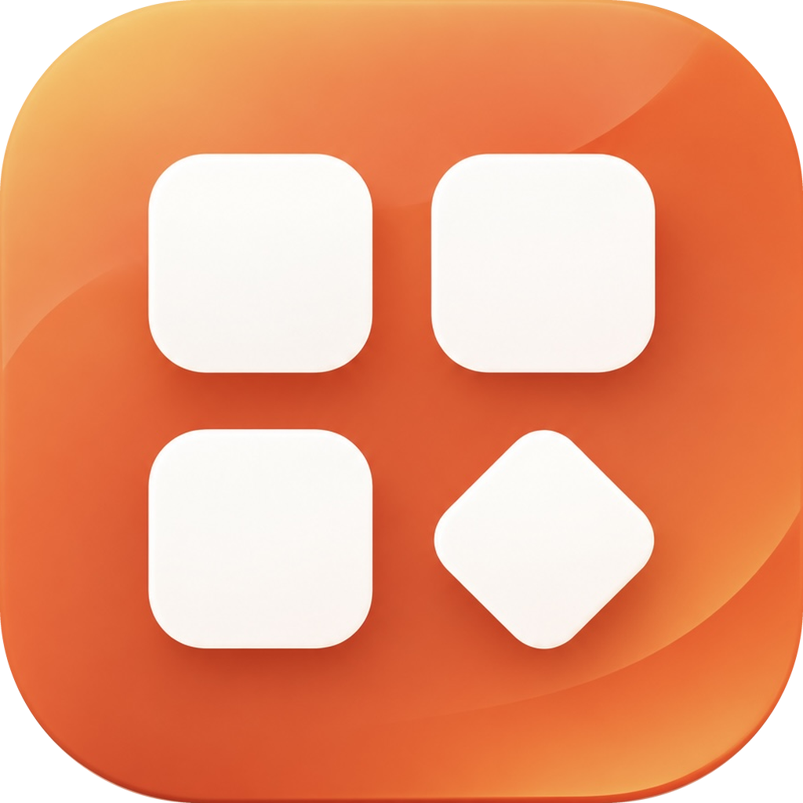

# Open Tools

English | [简体中文](README.zh-CN.md) | [日本語](README.ja.md)

**A developer toolbox for Windows**

JSON, encoding, conversion, image, audio, and document utilities in one desktop app. Most processing happens locally, without uploading your files.

[Download](#download-and-install) · [Features](#features) · [Tips](#tips) · [Star history](#star-history)

---

## Overview

Formatting JSON, decoding Base64, converting timestamps, or compressing images often means opening several websites and wondering where your data goes. Open Tools brings these everyday utilities into a single desktop app:

- **Local processing:** Your files and content are processed on your computer. See [Privacy](#privacy) for the features that access the network.
- **Ready to use:** The Windows installer includes the AI runtime. Models download on demand, and image inference runs locally.
- **AI Workspace:** Built-in AI chat supporting OpenAI, Anthropic, and Gemini APIs with built-in tool and MCP tool calling plus latency and token usage tracking; conversations and API keys stay local on your PC.
- **One workspace:** Switch categories at the top, choose tools in the sidebar, or press `Ctrl K` to search.
- **Keep your work:** Switching tools preserves recent inputs and results.
- **Home page:** Access favorites and recent tools, view usage activity, and check upcoming reminders.
- **Built-in updates:** Get notified when a new version is available and install it from the app.
- **Multiple languages:** The interface is available in Simplified Chinese, English and Japanese, following your system language by default.

## Features

9 categories and 74 tools:

| Category | Tools |
| --- | --- |
| Developer tools | JSON formatting and validation (code/tree views), comparison, escaping, YAML conversion and TypeScript type generation; Base64, URL/Unicode/HTML encoding, hashes, JWT decoding, regex testing, naming convention conversion, MCP Tool Viewer |
| Daily tools | Password generation, password vault, clipboard history, screenshots and desktop pinning, ID number parsing, Notebook |
| Time | Timestamp conversion, time zones and world clocks, cron expressions, clock (alarms with weekday repeats, stopwatch laps, multiple timers), calendar (Gregorian/lunar dates, holidays, notes and Windows desktop reminders) |
| Calculators & converters | Calculator, unit conversion, number bases |
| Images | Compression, format conversion, cropping, rotation, color adjustment, stitching, mosaic, watermarks, background removal (including AI subject detection), watermark removal (AI inpainting), image color picker, color conversion, DPI change, ICO generation |
| Audio | Compression, format conversion (including extracting audio from video), trimming, joining, recording, text to speech |
| Video | Video compression, Bilibili video download (with in-app playback), Douyin download without watermark, RedNote video and photo download (automatic content detection and local playback), X and Weibo video download, video to audio (copy the original track or convert to MP3/M4A/WAV), video to GIF, video trimming (length and picture), video concatenation, background music, screen recording, camera recording |
| Documents & files | Large-text editing (multiple tabs and continuous scrolling), Word to PDF, Word to Markdown, PDF to Word, Word watermarks and watermark removal, PDF content editing (existing text, added text, images, signatures and markup), PDF page management, PDF watermark removal, Markdown to Word conversion, archiving and extraction |
| Network | HTTP request client, IP address and location lookup, ping, MQTT (TCP/TLS and WebSocket), HTTP headers to JSON/cURL |

## Download and install

### Windows

1. Open the [latest GitHub release](https://github.com/Bulua/open-tools/releases/latest), or the [Gitee mirror](https://gitee.com/bulua/open-tools/releases).
2. Download `Open Tools_x.x.x_x64-setup.exe`.
3. Run the installer and launch Open Tools from the Start menu or desktop shortcut.

**Requirements:** 64-bit Windows 10 or 11 and WebView2. Local Word-to-PDF conversion requires Microsoft Word, WPS, or LibreOffice installed. PDF-to-Word conversion also offers a built-in method that does not require Office.

> **Windows SmartScreen warning on first launch?** The installer is not currently code-signed. If you trust the downloaded release, select **More info** and then **Run anyway**.

#### Windows Updates

The app checks for updates shortly after startup and opens an update dialog for new versions you have not skipped. Use Check for updates or the new-version entry at the bottom of the sidebar to view release notes, download, and install. Update checks try Gitee first, then GitHub.

## Tips

| Action | Result |
| --- | --- |
| `Ctrl K` | Search all tools by name or description and open one with Enter |
| Sidebar search | Filter tools in the current category |
| Favorite star | Add a tool to Home favorites; Home also shows recently used tools |
| Session tabs | JSON tools, regex testing, HTTP requests, and header conversion support independent sessions; use `+` to add one, double-click to rename, and middle-click or use `×` to close |
| `Ctrl V` | Paste screenshots or copied files into supported image and file tools |
| Drag and drop | Add images and files directly to the window |
| `Ctrl F` | Search in the JSON editor |
| Lower-left sidebar button | Collapse the sidebar |
| Theme button in the header | Switch between light and dark themes |
| Language button in the header | Switch between Follow system, 简体中文, English and 日本語 |
| Close the window | Hide the app in the system tray; click the tray icon to restore it, or right-click and choose Exit |
| Drag the divider | Resize the input/output panes in the JSON formatter; double-click to reset |

The app opens on Home and remembers the last selected tool in each category, theme, language, and commonly used tool options. Alarms and timers are saved; tasks that become due while the app is closed notify you at the next launch. The stopwatch is retained only during the current app session and does not keep running after exit.

## Privacy

Processing is local unless a feature explicitly needs network access:

- **Update checks:** Read release metadata from Gitee or GitHub without sending your files.
- **App icon sync:** Check icon configuration on Gitee or GitHub after startup and periodically while running, downloading icons when needed without uploading user files.
- **IP lookup:** Query public services (ip-api.com, ipwho.is, then ipapi.co). The queried IP is sent to the provider; ip-api.com uses unencrypted HTTP.
- **HTTP requests:** Send the configured headers, parameters, and request body to the server you specify.
- **Ping:** Send a ping to the host you enter.
- **MQTT:** Connect to the broker you specify and send connection credentials, subscriptions, and published messages. Connection passwords and message logs are kept in memory.
- **MCP Tool Viewer:** Connect to the configured MCP server over HTTP or launch the configured local program over stdio.
- **AI Workspace:** Sends prompts, context, and attached files only to the model API endpoints you configure; API keys are encrypted locally using Windows DPAPI.
- **Video downloads:** Contact the selected video platform and its media servers. If a direct RedNote request fails, the desktop app loads the share page in a hidden window; share URL parameters are sent to RedNote.
- **AI model downloads (background removal and inpainting):** Download a model only when you request it (the AI runtime, ONNX Runtime, ships with the installer), from ModelScope first and Hugging Face if that fails. Your images are processed locally.
- **Remote images in Markdown:** When exporting Markdown that references an HTTP(S) image to Word, the app fetches that image from its URL.

Some tools retain local history and connection settings. See [Data storage](docs/development/STORAGE.md) for locations and formats.

## Development

See the [development guide](docs/DEVELOPMENT.md) for Windows development, tool documentation, and packaging. The guides are written in Chinese.

## Star history

If Open Tools is useful to you, consider starring the project. Report bugs or suggest tools in [Issues](https://github.com/Bulua/open-tools/issues).

<a href="https://star-history.com/#Bulua/open-tools&Date">
  <picture>
    <source media="(prefers-color-scheme: dark)" srcset="https://api.star-history.com/svg?repos=Bulua/open-tools&type=Date&theme=dark" />
    
  </picture>
</a>

## License

[AGPL-3.0](LICENSE) © Bulua
